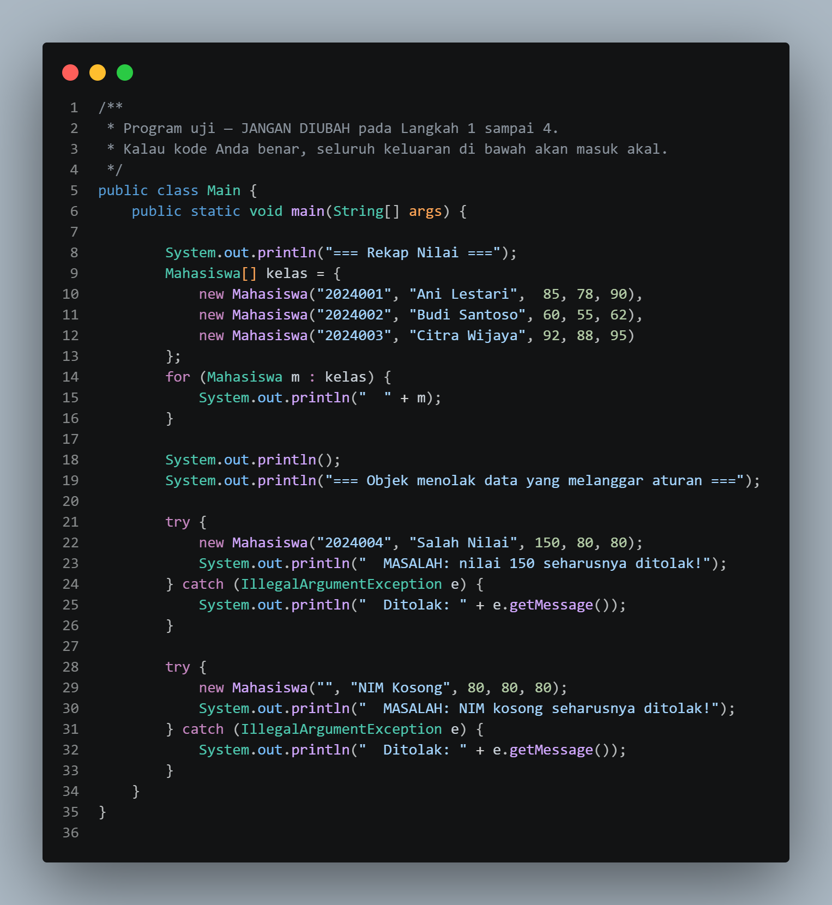
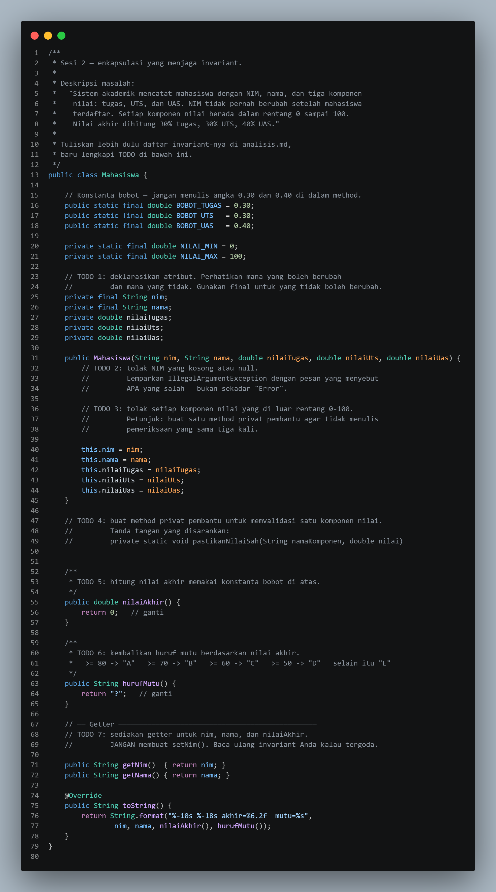
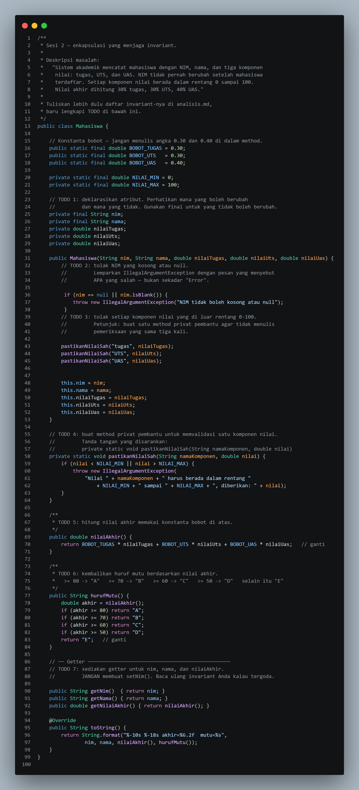
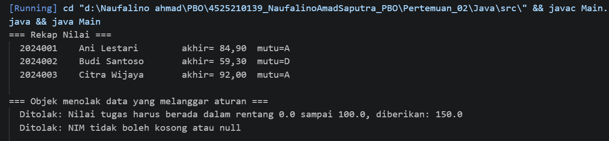
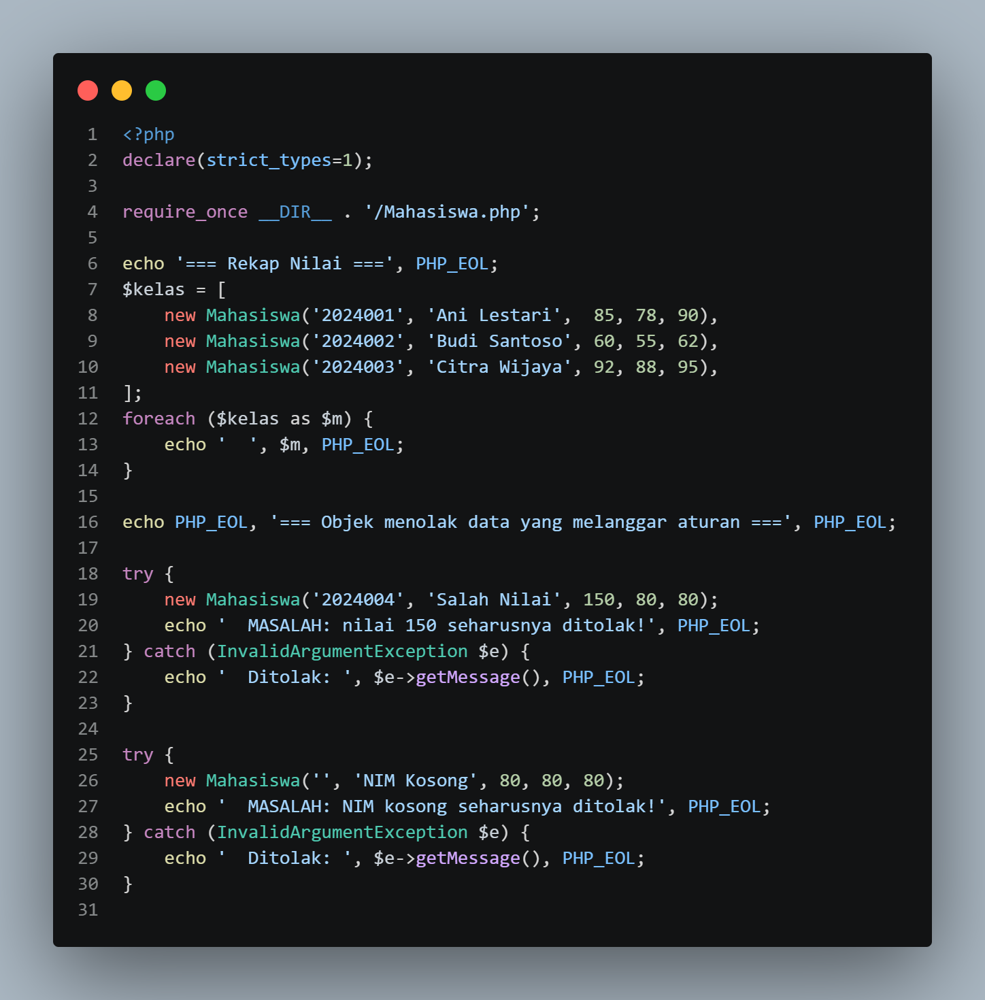
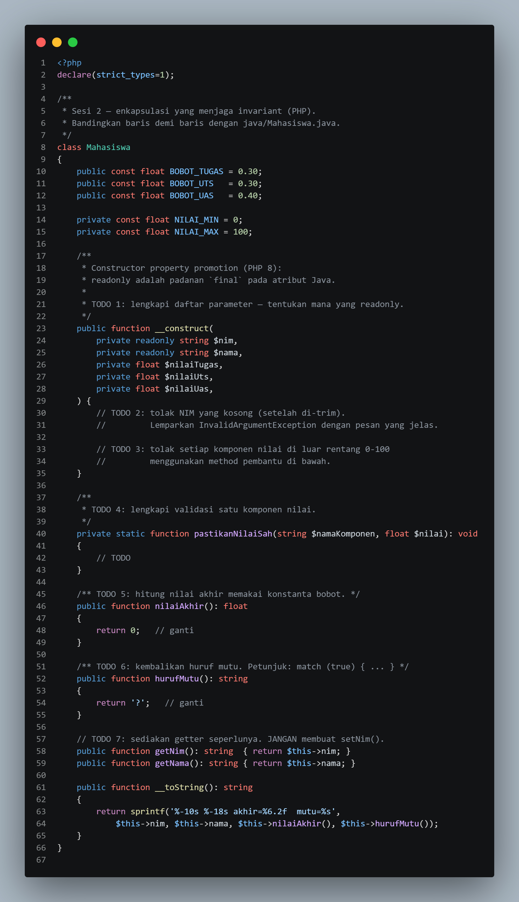
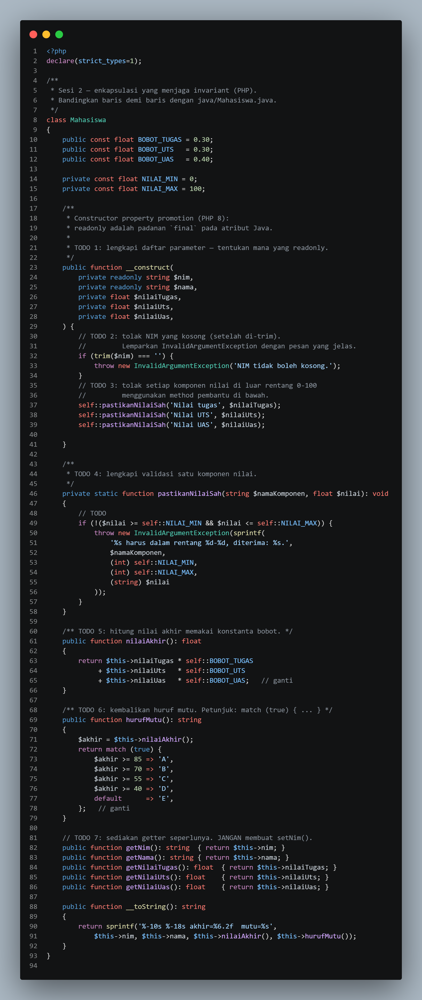
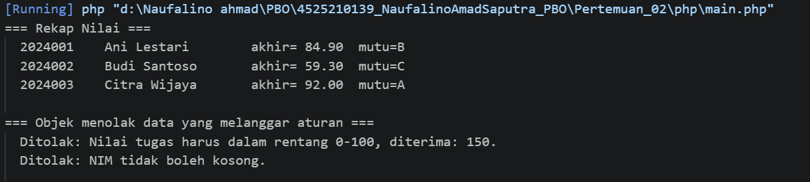

# LAPORAN PRAKTIKUM PEMROGRAMAN BERBASIS OBJEK
| Informasi Praktikan | Keterangan |
| :--- | :---: |
| Nama | Naufalino Ahmad saputra |
| NPM  | 4525210139 |
|Kelas | A |
|Mata Kuliah|Pemrograman Berbasis Objek (PBO) | 
|Pertemuan | 02 — Kelas, Objek, dan Enkapsulasi |
| Tanggal | Kamis 10 September 2026 | 

## 1. Implementasi Java

### 1.1 file `main.java`

#### Penjelasan Kode : 
> Program yang bertujuan untuk membuat beberapa objek Mahasiswa, Menampilkan rekap nilai, dan menguji penolakan data.

### Bukti Eksekusi (Screenshot):
<li> Before

<li> After

### 1.2 file `Mahasiswa.java`

#### Penjelasan Kode : 
> Merepresentasikan data mahasiswa. Atribut NIM dan nama dibuat tetap, namun untuk nilai tugas, UTS, dan UAS divalidasi agar hanya berada pada rentang 0–100. Nilai akhir dihitung dengan bobot tugas 30%, UTS 30%, dan UAS 40%.

### Bukti Eksekusi (Screenshot):
<li> Before

<li> After

### Output

## 2. Implementasi PHP

### 2.1 file `main.PHP`

#### Penjelasan Kode : 
> Program utama yang  memuat beberapa objek Mahasiswa, Menampilkan rekap nilai, dan mengambil NIM yang kosong.

### Bukti Eksekusi (Screenshot):
<li> Before

<li> After

### 2.2 file `Mahasiswa.PHP`

#### Penjelasan Kode : 
> Mengimplementasikan kelas mahasiswa dalam PHP

### Bukti Eksekusi (Screenshot):
<li> Before

<li> After

### Output

## 3. Kesimpulan

 <li> Kelas adalah cetakan atau cetak biru (blueprint).
 <li> Objek adalah hasil nyata yang dibuat dari cetakan tersebut.
 <li> Enkapsulasi adalah sistem keamanan yang membungkus dan melindungi data di dalam objek agar tidak bisa diubah sembarangan dari luar.

