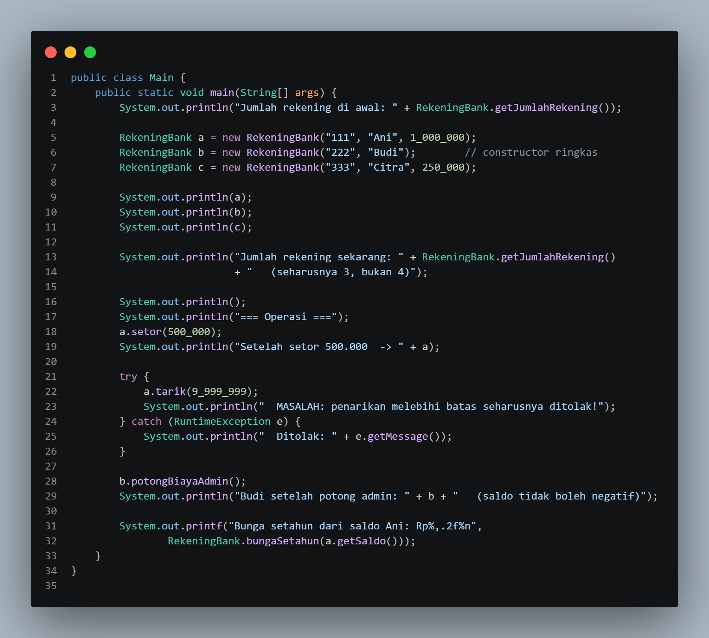
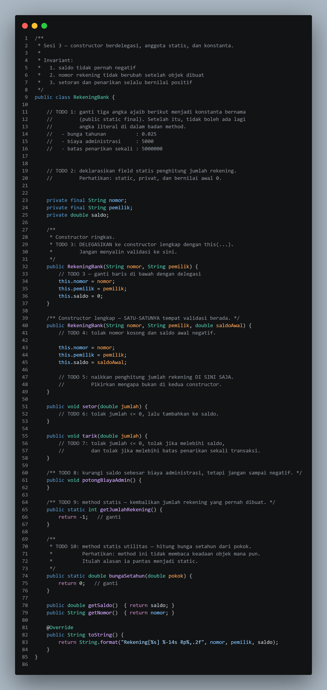
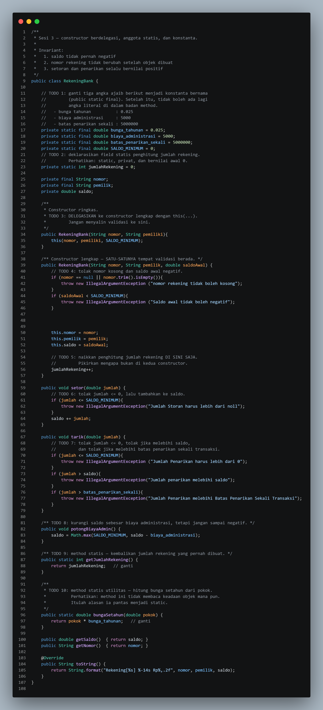
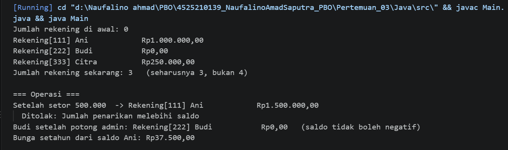
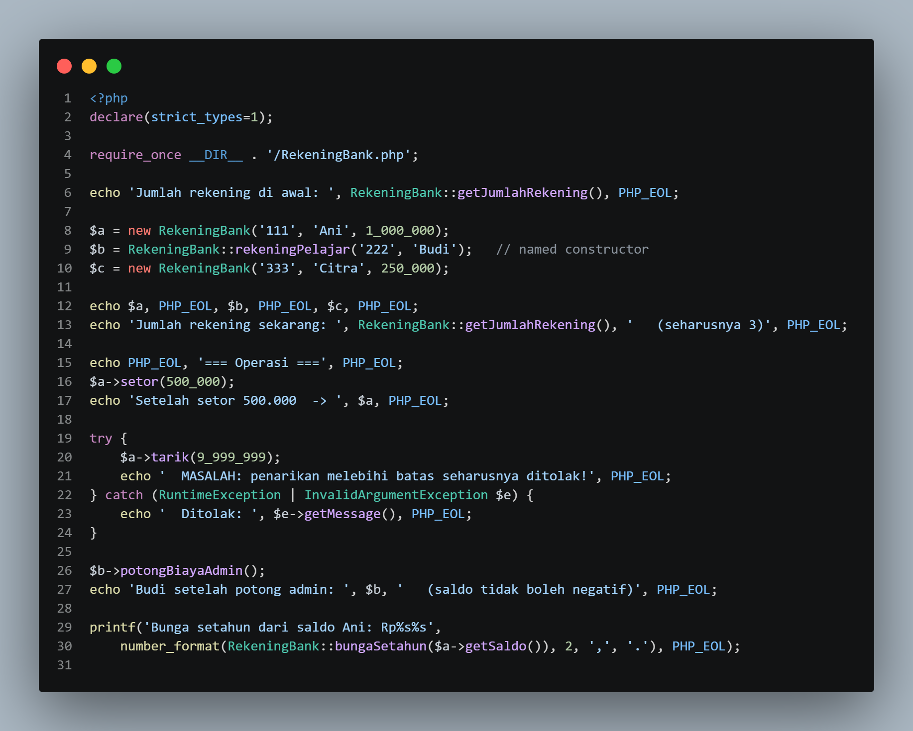
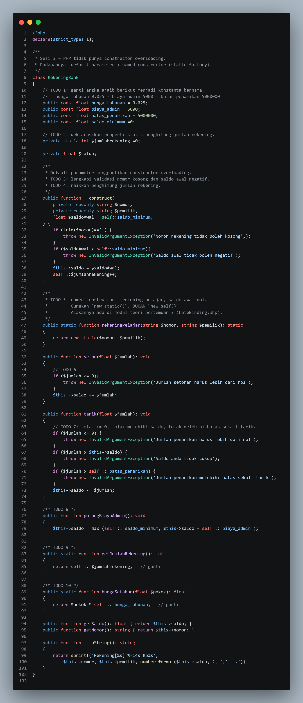
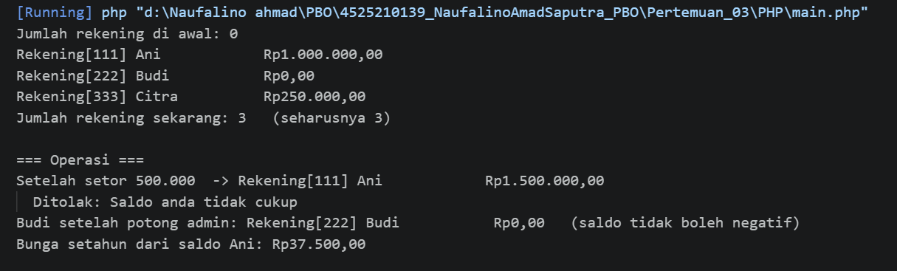

# LAPORAN PRAKTIKUM PEMROGRAMAN BERBASIS OBJEK
| Informasi Praktikan | Keterangan |
| :--- | :---: |
| Nama | Naufalino Ahmad saputra |
| NPM  | 4525210139 |
|Kelas | A |
|Mata Kuliah|Pemrograman Berbasis Objek (PBO) | 
|Pertemuan | 03 - Constructor, Anggota Statis, dan Konstanta |
| Tanggal | Kamis 17 September 2026 | 

## 1. Implementasi Java

### 1.1 file `main.java`

#### Penjelasan Kode : 
> Membuat rekening dengan konstruktor berupa jumlah rekening, operasi setor dan tarik, biaya administrasi, serta perhitungan bunga tahunan.

### Bukti Eksekusi (Screenshot):
<li> Before

<li> After

### 1.2 file `RekeningBank.java`

#### Penjelasan Kode : 
> Merepresentasikan rekening bank. Nomor rekening dan pemilik ditetapkan saat objek dibuat, saldo dijaga agar tidak negatif, dan operasi transaksi divalidasi.

### Bukti Eksekusi (Screenshot):
<li> Before

<li> After

### Output

## 2. Implementasi PHP

### 2.1 file `main.PHP`

#### Penjelasan Kode : 
> Membuat rekening dengan konstruktor berupa jumlah rekening, operasi setor dan tarik, biaya administrasi, serta perhitungan bunga tahunan.

### Bukti Eksekusi (Screenshot):
<li> Before

<li> After

### 2.2 file `RekeningBank.PHP`

#### Penjelasan Kode : 
> Merepresentasikan rekening bank. Nomor rekening dan pemilik ditetapkan saat objek dibuat, saldo dijaga agar tidak negatif, dan operasi transaksi divalidasi.

### Bukti Eksekusi (Screenshot):
<li> Before

<li> After

### Output

## 3. Kesimpulan

<li> Constructor adalah metode penyambutan yang otomatis berjalan untuk memberi nilai awal ketika sebuah objek baru dibuat.
<li> Anggota Statis adalah fasilitas bersama milik kelas yang bisa diakses langsung tanpa membuat objek, dan nilainya berbagi di antara semua objek.
<li> Konstanta adalah nilai mati/baku yang selamanya tidak bisa diubah setelah ditentukan demi menjaga keamanan data program.

