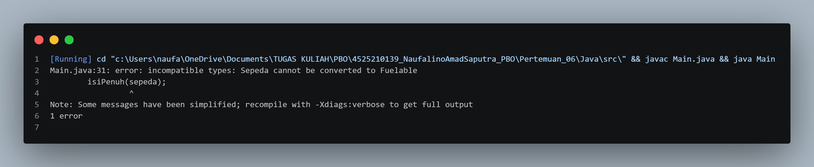
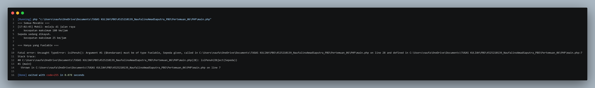

# Mengapa Penolakan Saat Kompilasi Menguntungkan?

**Type Safety:** Menangkap kesalahan logika atau tipe data lebih awal sebelum program dijalankan (runtime).  
**Mencegah Crash:** Menghindari kegagalan program di lingkungan produksi (seperti ClassCastException).  
**Feedback Cepat:** Developer langsung mengetahui batas kemampuan suatu objek tanpa perlu melakukan manual testing.

## Output

### Java

### PHP

