# LAPORAN PRAKTIKUM PEMROGRAMAN BERBASIS OBJEK
| Informasi Praktikan | Keterangan |
| :--- | :---: |
| Nama |Naufalino Ahmad saputra |
| NPM  |4525210139 |
|Kelas |A |
|Mata Kuliah|Pemrograman Berbasis Objek (PBO) | 
|Pertemuan |07 - Relasi Objek dan UML Class Diagram |
| Tanggal |Kamis 15 Oktober 2026 | 

## Implementasi Java
 
<b> 1.1. file `Main.java` </b>
 
### Penjelasan Kode
 
> File ini berfungsi sebagai program utama untuk menguji seluruh kelas lain. Bagian pertama membuktikan komposisi: sebuah Buku diberi tiga Bab, lalu dicoba mengosongkan daftar bab dari luar lewat `getBab().clear()` dan ternyata ditolak. Bagian kedua membuktikan agregasi: dua Mahasiswa dibuat di luar lalu didaftarkan ke Jurusan, dan Mahasiswa yang dikeluarkan tetap ada sebagai objek. Bagian ketiga mencoba PerpustakaanService untuk menambah koleksi, mencari buku, serta memproses peminjaman dan pengembalian.
 
**Bukti Eksekusi (Screenshot):**
 
<li> <b>Before </b>

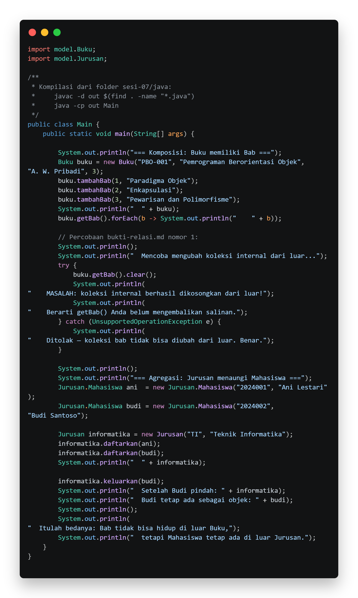
 
<li> <b>After </b>

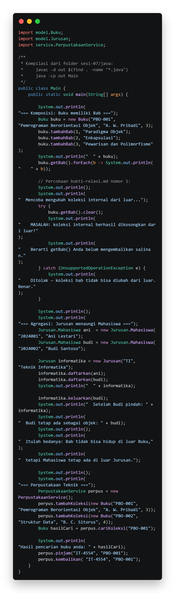
 
<b> 1.2. file `Buku.java` </b>
 
> Buku adalah contoh komposisi. Bab hanya lahir lewat `tambahBab(nomor, judulBab)`, yang menerima nomor dan judul (bukan objek Bab) lalu membuat objek Bab di dalam Buku. Kelas Bab adalah nested class dengan constructor private, sehingga hanya Buku yang dapat membuatnya. Method `getBab()` mengembalikan salinan tak-berubah dengan `List.copyOf`, constructor menolak jumlah eksemplar negatif, dan `kurangiStok()` mengurangi stok selama stok belum nol.
 
**Bukti Eksekusi (Screenshot):**
 
<li> <b>Before </b>

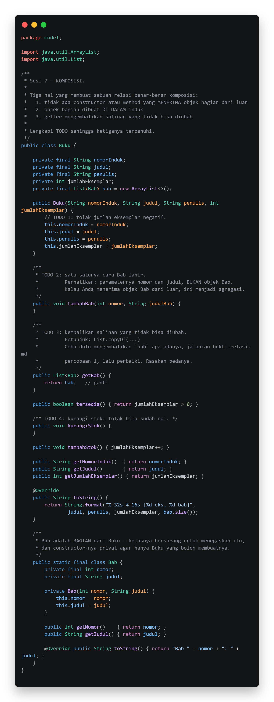
 
<li> <b>After </b>

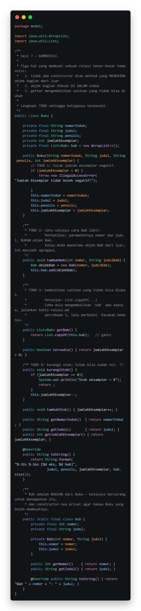
 
<b> 1.3. file `Jurusan.java` </b>
 
> Jurusan adalah contoh agregasi sebagai pembanding komposisi. Objek Mahasiswa dibuat di luar (constructor-nya public) lalu diterima lewat `daftarkan()`, yang menolak nilai null. Method `keluarkan()` hanya melepas Mahasiswa dari daftar, sedangkan objeknya tetap hidup di luar Jurusan. Method `getMahasiswa()` mengembalikan salinan tak-berubah.
 
**Bukti Eksekusi (Screenshot):**
 
<li> <b>Before </b>

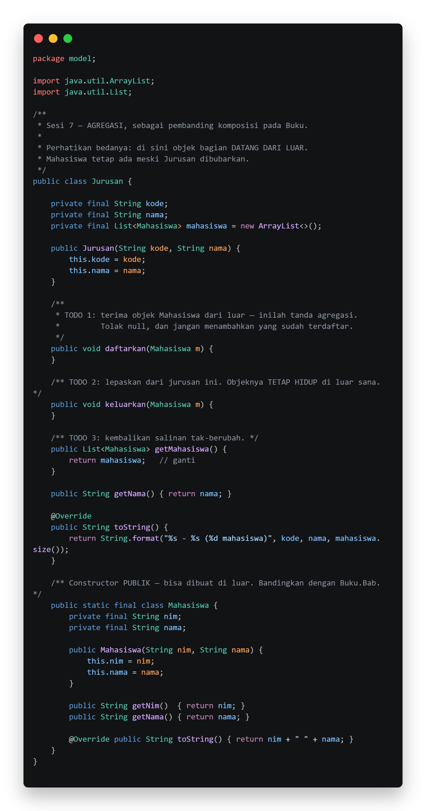
 
<li> <b>After </b>

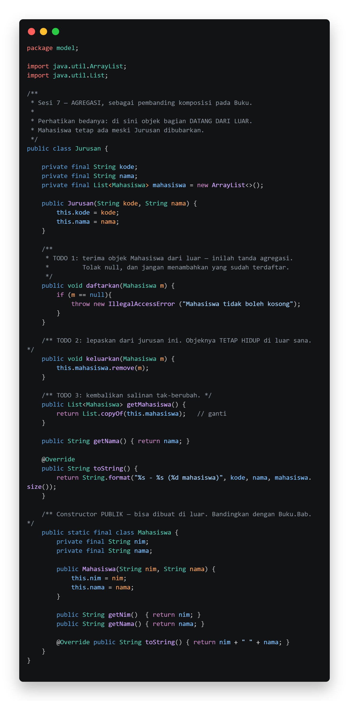
 
<b> 1.4. file `PerpustakaanService.java` </b>
 
> PerpustakaanService adalah lapisan layanan yang menyimpan koleksi dalam `ArrayList<Buku>`. Hubungannya dengan Buku adalah agregasi, karena objek Buku dibuat di luar lalu diserahkan lewat `tambahKoleksi()`. Method `cariKoleksi()` mencari buku berdasarkan nomor induk, sedangkan `pinjam()` dan `kembalikan()` pada tahap ini masih berupa kerangka yang mencetak keterangan peminjaman dan pengembalian.
 
**Bukti Eksekusi (Screenshot):**
 
<li> <b>Before </b>

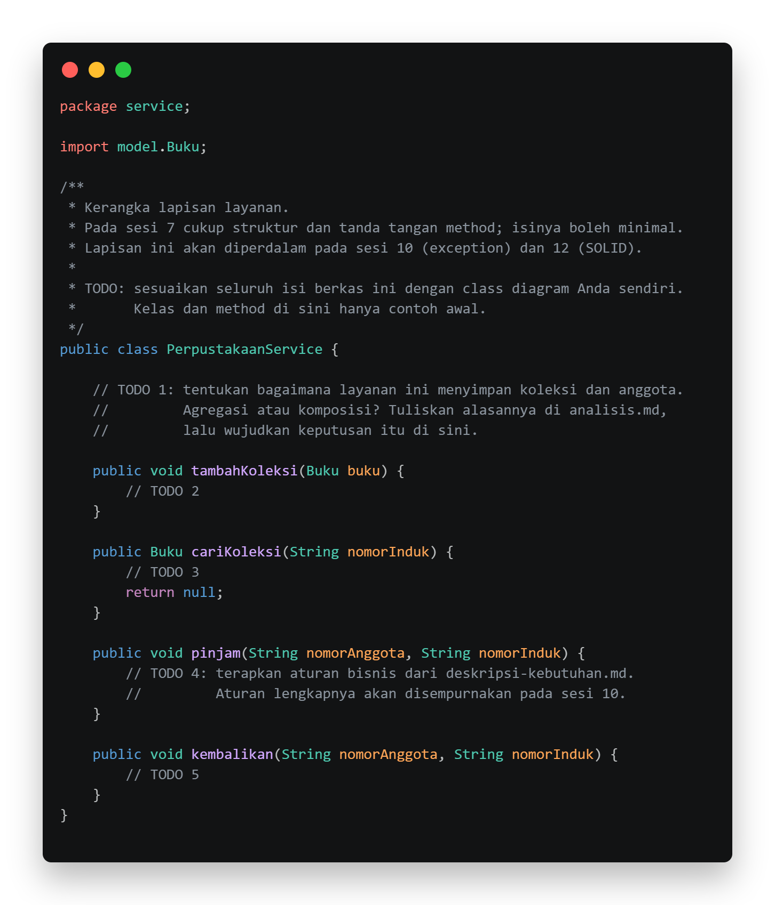
 
<li> <b>After </b>

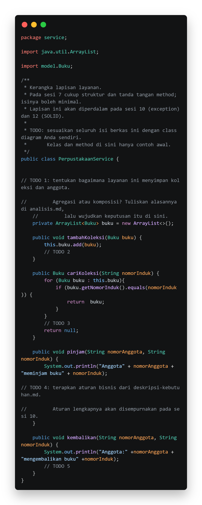
 
## Implementasi PHP
 
<b> 2.1. file `main.php` </b> 
 
**Penjelasan Kode**
 
> File ini adalah program utama versi PHP. Di dalamnya dibuat objek Buku beserta tiga Bab untuk memperlihatkan komposisi, lalu objek Mahasiswa dibuat di luar dan didaftarkan ke Jurusan untuk memperlihatkan agregasi. Setelah Mahasiswa dikeluarkan, objeknya tetap bisa dicetak sehingga terbukti masih hidup.
 
**Bukti Eksekusi (Screenshot):**
 
<li> <b>Before </b>

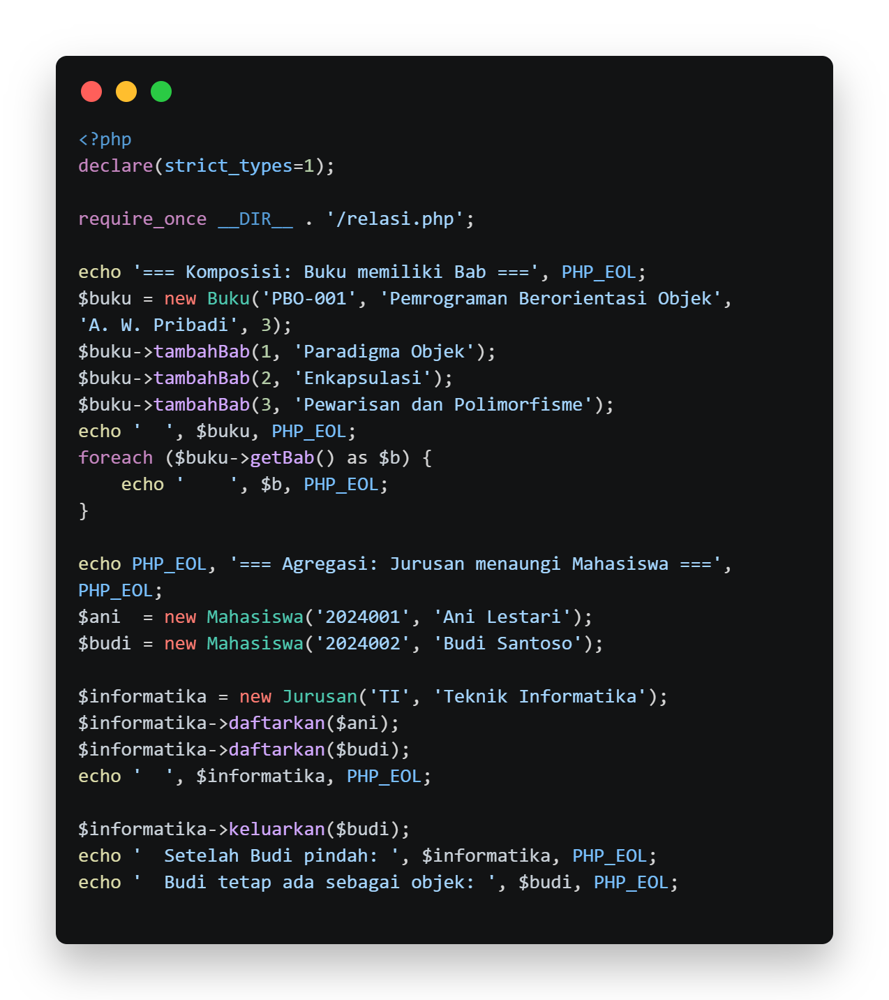
 
<li> <b>After </b>

 
<b> 2.2. file `relasi.php` </b> 
 
**Penjelasan Kode**
 
> File ini menghimpun kelas Bab, Buku, Mahasiswa, dan Jurusan dalam PHP. Kelas Bab memakai constructor dengan properti readonly. Karena PHP tidak punya nested class, komposisi dijaga lewat konvensi bahwa Bab hanya dibuat dari dalam `Buku::tambahBab()`. Method `getBab()` mengembalikan array by-value, sehingga pemanggil hanya mendapat salinan larik-nya, sedangkan objek Bab di dalamnya tetap berbagi referensi dan dilindungi oleh sifat readonly. Jurusan menerima Mahasiswa dari luar (agregasi) dan melepasnya lewat `keluarkan()` tanpa menghapus objeknya.
 
**Bukti Eksekusi (Screenshot):**
 
<li> <b>Before </b>

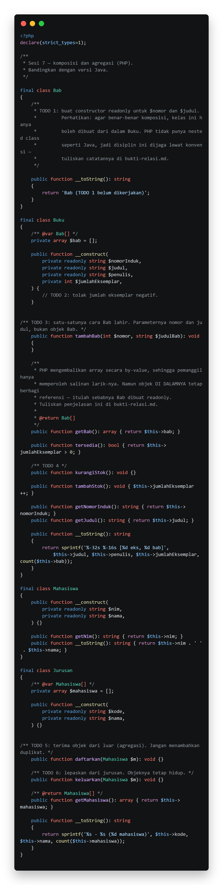
 
<li> <b>After </b>

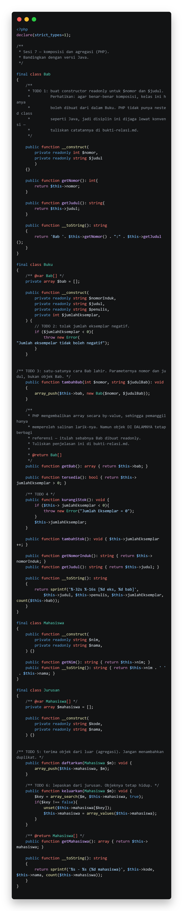
 
 
## Kesimpulan
 
> Dapat disimpulkan bahwa komposisi dan agregasi sama-sama menyatakan hubungan "memiliki", tetapi berbeda pada nasib objek bagiannya. Pada komposisi, seperti Buku dan Bab, objek bagian dibuat di dalam induk, constructor-nya dibatasi, dan getter mengembalikan salinan tak-berubah, sehingga Bab tidak bermakna tanpa Buku dan ikut hilang bersamanya. Pada agregasi, seperti Jurusan dan Mahasiswa atau PerpustakaanService dan Buku, objek bagian dibuat di luar lalu diserahkan ke induk, sehingga tetap hidup walaupun dilepas atau induknya hilang.