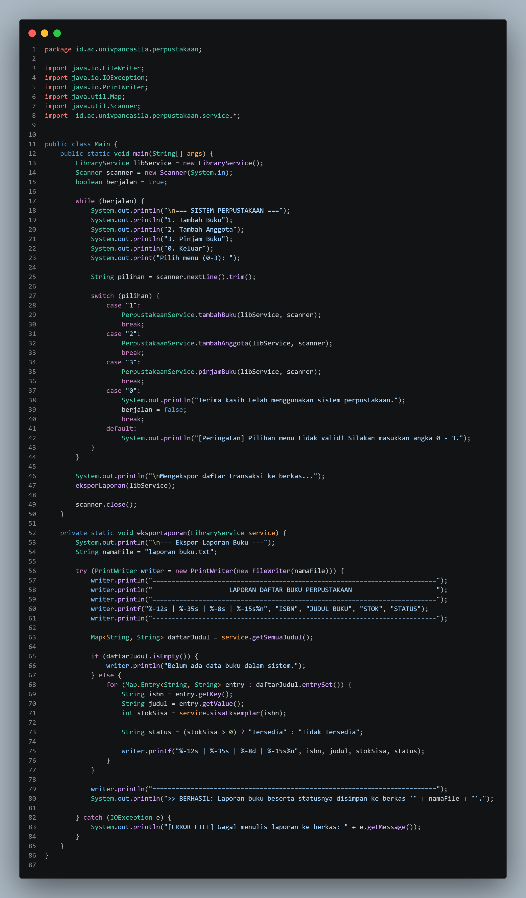

# LAPORAN PRAKTIKUM PEMROGRAMAN BERBASIS OBJEK
| Informasi Praktikan | Keterangan |
| :--- | :---: |
| Nama |Naufalino Ahmad saputra |
| NPM  |4525210139 |
|Kelas |A |
|Mata Kuliah|Pemrograman Berbasis Objek (PBO) | 
|Pertemuan |10 - Exception Handling dan Pemrograman Difensif |
| Tanggal |Kamis 5 November 2026 | 

## Implementasi Java

## Struktur Folder

```
java/
├── pom.xml                              
├── struktur.txt                         
├── laporan_buku.txt                     
├── src/
│   └── main/
│       └── java/
│           └── id/ac/univpancasila/perpustakaan/
│               ├── Main.java                         
│               ├── exception/
│               │   ├── PerpustakaanException.java            
│               │   ├── AnggotaTidakDitemukanException.java
│               │   ├── BatasPinjamTerlampauiException.java
│               │   ├── BukuSedangDipinjamException.java
│               │   └── BukuTidakDitemukanException.java
│               ├── model/
│               │   ├── Anggota.java                          
│               │   ├── Buku.java                             
│               │   └── Jurusan.java                          
│               ├── service/
│               │   ├── LibraryService.java                   
│               │   ├── LibraryServiceKotor.java              
│               │   └── PerpustakaanService.java              
│               └── util/
│                   └── format.java                           
└── target/                             
```
 
## Penjelasan Code 

### 1. id/ac/univpancasila/perpustakaan/Main.java
Titik masuk aplikasi (`main`). Di sini dibuat satu objek `LibraryService` (penyimpan data) dan satu `Scanner` (pembaca input keyboard).



### 2. 