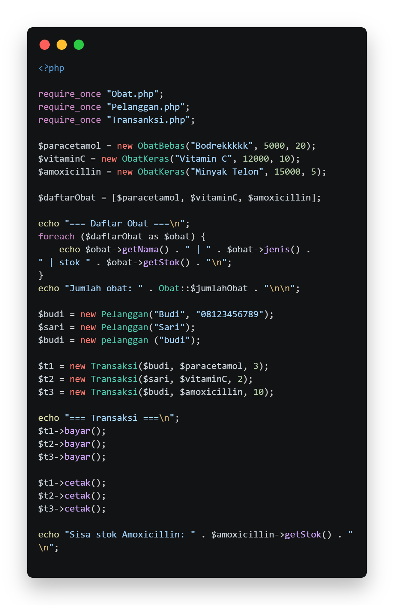
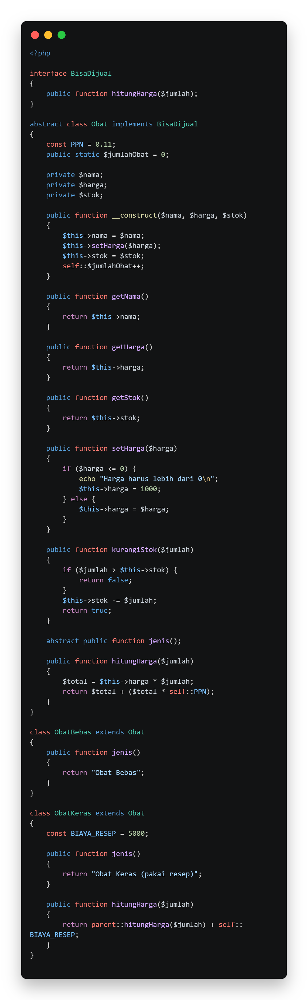
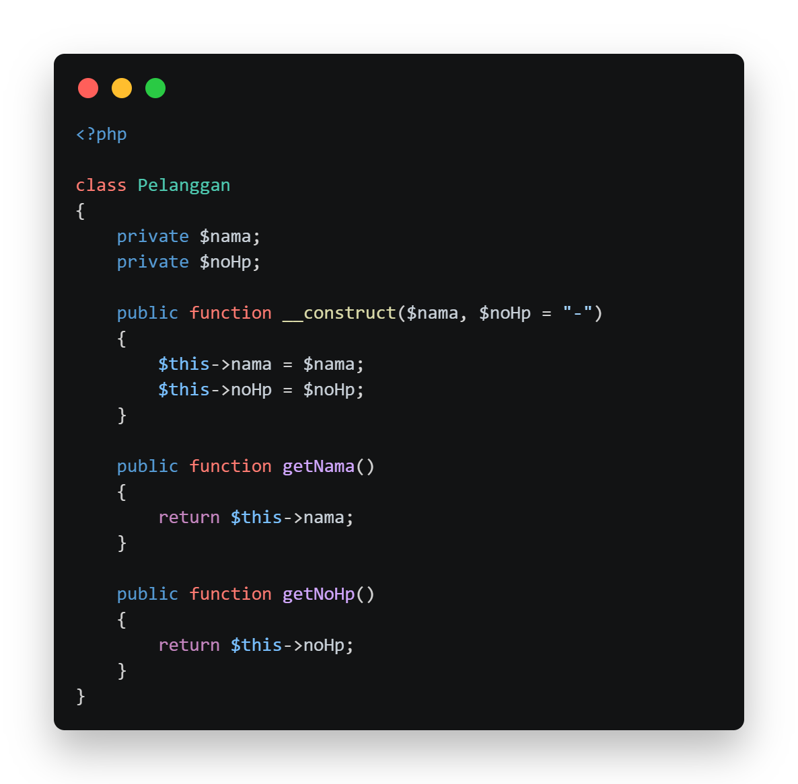
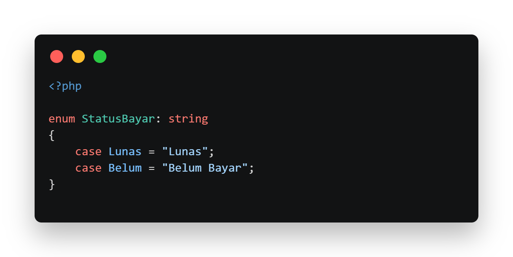
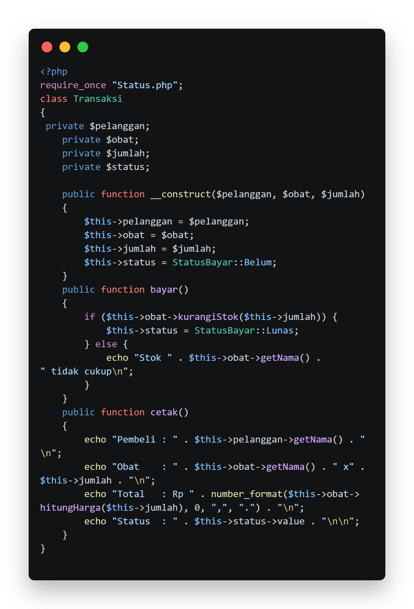
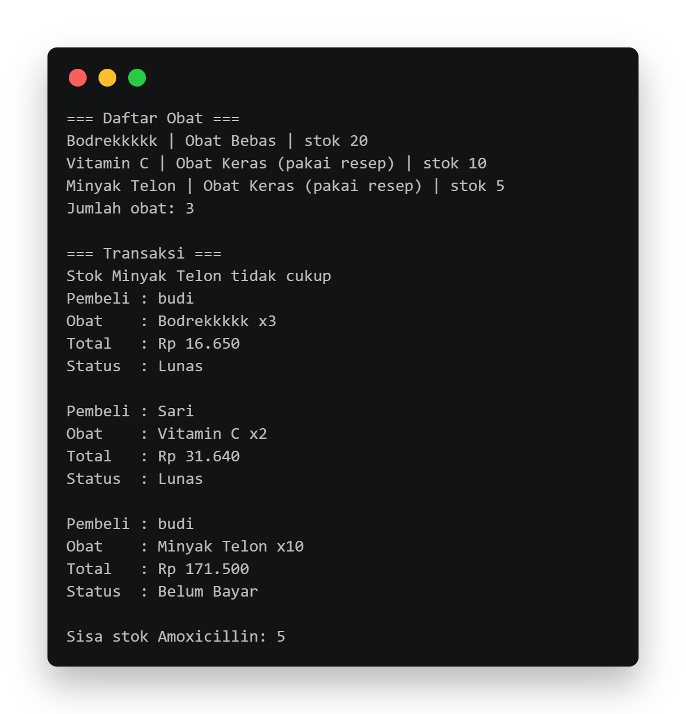

# LAPORAN UTS PRAKTIKUM PEMROGRAMAN BERBASIS OBJEK

| Informasi Proyek | Keterangan |
| :--- | :--- |
| **Mata Kuliah** | Pemrograman Berbasis Objek (PBO) |
| **Kelas** | A |
| **PJ** | Muhammad Edvin Hidayat |
| **Tema** | Apotek |
| **Tanggal** | 22 Oktober 2026 |
| **Nama** | Naufalino Ahmad Saputra |
| **NPM** | 4525210139 |

---

## Detail Pengerjaan & Anggota Kelompok

# Pembagian Tugas Anggota Kelompok

## Daftar Anggota dan Tugas

| Nama | NPM | Tugas / Fitur yang Dikerjakan |
| :--- | :--- | :--- |
| Muhammad Syamil | 4525210130 | Mengerjakan `Status.php` (Enum) |
| Rangga Prataya Setiono Putro | 4525210131 | Mengerjakan `Pelanggan.php` (Class, Encapsulation, Constructor, Object) |
| Qowiyul Amin | 4525210135 | Mengerjakan `Obat.php` |
| Arkan Abdul Hafizh | 4525210137 | Mengerjakan `Transaksi.php` (Class, Object, Construction, Encapsulation) |
| Naufalino Ahmad Saputra | 4525210139 | Mengerjakan `Obat.php` (Class, Object, Constructor, Inheritance, Abstract) |
| Ayu Arrimbi | 4525210140 | Mengerjakan `Transaksi.php` (Class, Object, Construction, Encapsulation) |
| Muhammad Salman Al Farisi | 4525210141 | Mengerjakan `Pelanggan.php` (Class, Encapsulation, Constructor) |

---

## Deskripsi Proyek
> Aplikasi yang dibangun pada proyek UTS ini adalah Sistem Penjualan Obat Apotek berbasis PHP. Aplikasi ini bertujuan untuk mengelola data obat, data pelanggan, dan transaksi pembelian obat secara sederhana. Aplikasi ini membantu proses penjualan obat dengan menyediakan informasi nama obat, jenis obat, harga, dan stok yang tersedia. Selain itu, aplikasi dapat menghitung total harga pembelian beserta PPN sebesar 11%, menambahkan biaya resep untuk obat keras, serta memperbarui status pembayaran dan mengurangi stok obat setelah transaksi berhasil dilakukan.

**Daftar Fitur:**
1. Pengelolaan Data Obat
2. Klasifikasi Jenis Obat
3. Pengelolaan Data Pelanggan
4. Transaksi Pembelian Obat
5. Perhitungan Total Harga
6. Pengelolaan Stok Obat
7. Status Pembayara

---

## 1. Implementasi PHP

### 1.1. File: `Main.php`
**Penjelasan Kode:**
> Program utama yang membuat objek obat dan pelanggan, menjalankan transaksi, serta menampilkan hasilnya.

**Screenshot Kode:**

### 1.2. File: `Obat.php`
**Penjelasan Kode:**
> Mengelola data obat, harga, stok, jenis obat, dan perhitungan harga serta biaya resep untuk obat keras.

**Screenshot Kode:**

### 1.3. File: `Pelanggan.php`
**Penjelasan Kode:**
> Menyimpan data pelanggan berupa nama dan nomor telepon menggunakan konsep class, constructor, dan encapsulation. 

**Screenshot Kode:**

### 1.4. File: `Status.php`
**Penjelasan Kode:**
> Menggunakan enum untuk menentukan status pembayaran, yaitu Lunas dan Belum Bayar.

**Screenshot Kode:**

### 1.5. File: `Transaksi.php`
**Penjelasan Kode:**
> Mengelola transaksi pembelian, memeriksa ketersediaan stok, memperbarui status pembayaran, dan mencetak detail transaksi.

**Screenshot Kode:**

### Output
**Hasil Running Program (Java):**

---

## 3. Kesimpulan
> Proyek UTS Sistem Penjualan Obat Apotek berhasil menerapkan konsep Pemrograman Berorientasi Objek menggunakan PHP. Konsep seperti class, object, encapsulation, inheritance, abstract class, interface, dan enum digunakan untuk mengelola data obat, pelanggan, serta transaksi pembelian. Melalui proyek ini, kami memahami penerapan PBO dalam menyelesaikan permasalahan. Kolaborasi tim juga membantu anggota berbagi tugas, Membantu satu sama lain, dan menggabungkan hasil pekerjaan agar program dapat berjalan dan selesai lebih cepat.